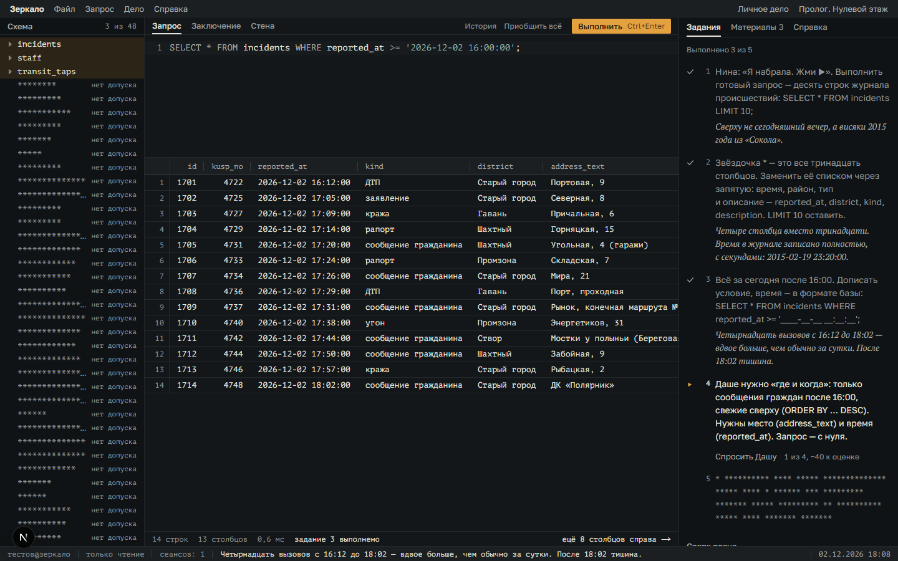
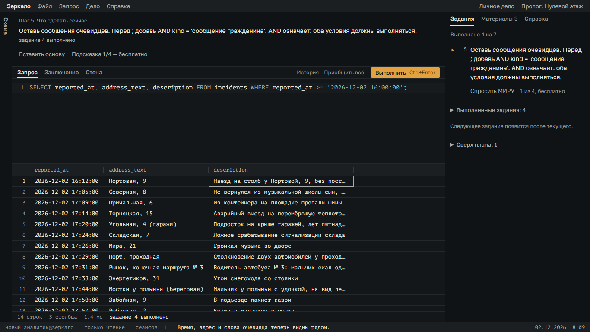
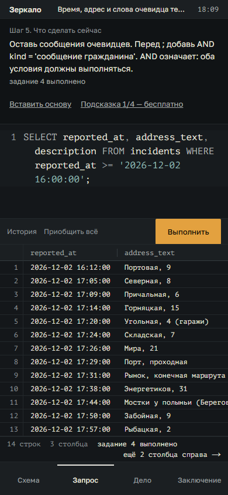
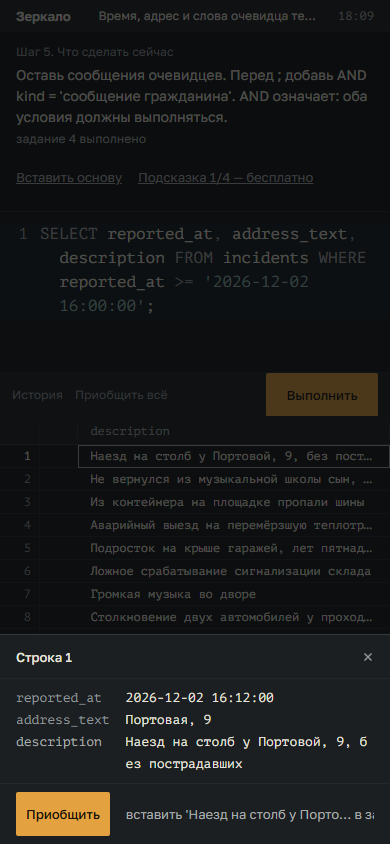
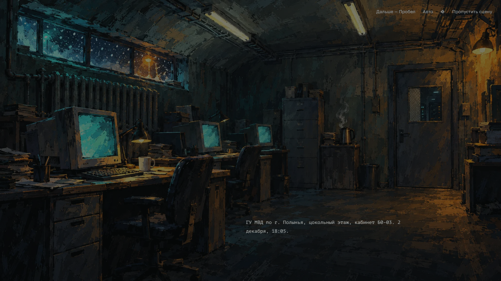

# ZeroSQL: проверка и изменения первого сеанса

Дата: 1 ноября 2026. Исходная ревизия: `347e41e`. Изменения локальные, сайт не публиковался.

Прочитаны `CLAUDE.md`, `docs/reviews/UX_AUDIT_RU.md`, принципы и ограничения `UI_ART_DIRECTION.md`, контракты задач, стора и сохранений. Исходный аудит оставлен без изменений.

## Как проверено

Sparse checkout содержал только служебные файлы. Полное дерево восстановлено из текущего Git-снимка. Установлены зависимости по lock-файлу; отдельный Playwright установлен во временный каталог, зависимости проекта не менялись. Мост интерактивного браузера оказался недоступен, поэтому проверка выполнена Chromium/Playwright через настоящий UI и снимки экрана.

До изменений запущен локальный Next.js. Пройден путь чистого профиля: предупреждение → холодное открытие → вход → имя/режим → журнал → пролог → готовый SELECT → остальные задачи → заключение → развязка → разбор → «Медь». Пролог и первое дело завершены через интерфейс. Сцены ускорены штатной кнопкой пропуска, выборы сделаны кнопками, SQL вводился в CodeMirror, ответы заключения выбирались из найденных данных. Состояние читалось из сохранения; задачи не отмечались выполненными через внутренние API.

Автопрохождение использует эталонные запросы. Это проверка работоспособности, а не свидетельство, что новичок самостоятельно понял SQL. Времена в JSON-отчётах — время автоматизации, не время человека.

Опубликованная версия открыта отдельно до предупреждения 18+. Повторное полное прохождение опубликованного сайта не выполнялось. Наблюдения предыдущего аудита о её экскурсии и пяти разделах не выдаются за собственные наблюдения этого прохода.

## Что подтвердилось и что уточнено

| Проверка | Локальный результат и решение |
|---|---|
| Цель после успеха | Код действительно подменял текущую цель текстом прошлого успеха в узкой полосе. Теперь инструкция и обратная связь показаны отдельно, на всех размерах. |
| Запрос и результат | Уже объединены в локальной версии. Сохранили эту основу; на узком экране добавили общий вертикальный поток с достаточной высотой результата. |
| Закрытые таблицы | В локальной версии действительно были десятки отдельных закрытых строк. Теперь свёрнуты; сама схема по умолчанию занимает узкую полосу и раскрывается кнопкой. |
| История заданий | Выполненные и будущие задачи вытесняли активную. Выполненные и дополнительные свёрнуты, будущие заменены одной нейтральной строкой. |
| p4 | Одновременно требовал выбор полей, второе условие и сортировку с нуля. Перед сортировкой добавлены два самостоятельных шага. |
| Помощь | Последняя подсказка пролога и основных задач «Меди» содержала намеренную ошибку. Теперь это корректный пример и явная кнопка вставки. |
| p2 | Дополнительный id принимался намеренно тестами альтернативных решений. Проверку не ужесточали: важны нужные поля и правильные строки, а не единственная форма SQL. |
| Описания результата | На компьютере выбранное значение повторно обрезалось; на телефоне даже раскрытие строки использовало обрезающий компонент. Теперь в раскрытии значение полное; узкий экран с мышью также открывает строку. Enter открывает строку, Escape закрывает. |

## Реализованный учебный маршрут

Пролог: готовый запрос → выбор четырёх полезных полей → фильтр времени → время/адрес/описание рядом → сообщения граждан через AND → свежие сверху через DESC → подпись исполнителя → заключение.

«Медь»: знакомый фильтр краж → поиск «кабел» через LIKE → диапазон дат → одна ночь камеры с правкой образца номера → три окна OR в скобках с правкой даты в основе → DISTINCT как отдельный приём → прежние задачи реестра и расследования.

Каждая основа вставляется только по нажатию. Можно вернуть предыдущий запрос. Последний уровень помощи вставляет рабочий пример, который игрок запускает самостоятельно. Собственный SQL остаётся доступным, проверка результатов ядром сохранена.

Новые профили начинают в режиме «Новичок». Все его подсказки бесплатны, что теперь соответствует описанию режима. В прологе бесплатны все доступные уровни при любой сложности; помощь не уменьшает мастерство. Режимы старых профилей не меняются. После регистрации первый сеанс сразу открывает пролог, без выбора единственного дела в журнале. Журнал остаётся доступен.

Добавлена миграция сохранения 2 → 3: решённый p4 включает p3a/p3b; решённые o1_1/o1_2 включают соответствующие новые подшаги. Черновик, журнал, улики и выбранный режим сохраняются. Незавершённые задания проходят новую последовательность.

## Что сохранено

Не изменены `public/`, сценарии `script.json`, ID существующих озвученных реплик, персонажи, сюжетные выборы, сцены развязки, звуковая система и изображения. Новые промежуточные инструкции — служебный текст МИРА, без фиктивных ссылок на несуществующую озвучку. Сохранены свободные запросы, история, справочник, материалы, стена, дополнительные задания и заключение.

Первый SELECT по-прежнему возвращает исходные 13 столбцов; UI не маскирует фактический результат запроса. Следующий шаг сужает его до полезных полей. Задача staff перед заключением оставлена ради существующей сцены самоидентификации: перенос после спасения потребовал бы отдельной переработки сюжетного потока. Пятиэкранная экскурсия опубликованной версии в локальном маршруте не обнаружена и заново не создавалась.

## Проверки итоговой версии

- TypeScript: `npx tsc --noEmit -p .` — успешно.
- ESLint: `npm run lint` — без ошибок и предупреждений.
- Vitest: `npm run test:run` — **1713 тестов, 51 файл**, успешно; включает все 13 дел сезона, разные корректные запросы, неверные ответы и воспроизведение сохранений.
- `npm run build` — успешная производственная сборка.
- Производственный сервер: UI-прохождение пролога и «Меди» — **2/2**, по 8 запросов с дополнительными заданиями, ошибок консоли **0**.
- `scripts/qa-onboarding.mjs`: новый профиль, автозапуск пролога, актуальная цель, четыре уровня помощи, вставка/отмена, перезагрузка, ошибка SQL без перехода к следующей задаче, новые подшаги, схема, полное раскрытие текста, переход к заключению — успешно.
- Размеры проверки: **1366×768** и **390×844** с эмуляцией касания. На узком экране нет горизонтальной прокрутки страницы; таблица прокручивается внутри своей области.
- Отдельные тесты: бесплатность помощи в стандартном прологе и отсутствие потери мастерства; миграция старых завершённых этапов без потери черновика.

Команды браузерной проверки при установленном Playwright и запущенном сервере:

```powershell
node scripts/qa-onboarding.mjs http://localhost:3152 ./qa-onboarding
node scripts/qa-playthrough.mjs --base-url http://localhost:3152 --cases 0-1 --shots-dir ./qa-shots
```

Если Playwright установлен отдельно, укажите путь к модулю в `PLAYWRIGHT_MODULE`. Готовые отчёты: [маршрут новичка](ux-validation/onboarding-report.json), [пролог и «Медь»](ux-validation/playthrough-report.json).

## Визуальные свидетельства

Исходный стол (1440×900):



Обновлённый стол (1366×768):



Узкий экран (390×844):



Полное описание строки:



## Границы результата

Не проводились тесты с реальными начинающими игроками. Снижение числа ошибок и времени до понимания пока не измерено. Аудиофайлы и привязки сохранены, но качество звучания и синхронизация голосов на слух не оценивались. Следующий содержательный этап исследования — наблюдение за людьми без знания SQL на обновлённом маршруте.

## Уточнение после проверки изображений

Файлы ассетов не удалялись, но это не означало их фактическую доступность в игре. В исходном снимке отсутствуют `public/portraits` и `public/sfx`; `art-src` содержит исходники и референсы, которые игра напрямую не использует. Единственный готовый фон `basement_b0_03_evening.webp` не передавался из сюжетного слоя в проигрыватель диалогов. Эта связь исправлена: фон показывается в сценах соответствующей локации. Браузерная проверка проверяет декодирование изображения и сохраняет снимок сцены. TypeScript, ESLint и производственная сборка прошли.


